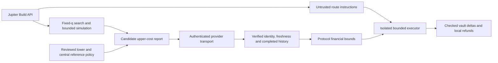

# Pump curves and broad Jupiter execution — design proposal

**Status: design and isolated prototypes; production integration is unimplemented.**
The owner [postponed first mainnet](../audit/owner-jupiter-redesign-decision-2026-10-27.md)
for this redesign. The owner selected signed Jupiter-derived feeds for new markets; concrete
provider/trust/settings remain subject to review before deployment. The deployed
program remains the 1.0.3 baseline. The initial prototype CI reproduced its exact
Anchor/verifier bytes; this does not qualify future integration changes. No final
version is selected.

## Product boundary

Keep the direct Pump bonding-curve path and its graduation handling. Add a
general Jupiter execution path for eligible post-curve/other assets. This can
reach liquidity on supported Meteora, Orca, Raydium and PumpSwap pools without
making a new direct execution adapter for every pool family. It does not
automatically establish independent pricing or make every token shortable.

A market still needs safe supported mint semantics, deposited lender inventory,
independently established risk inputs, a usable execution route within resource
limits, and defined liquidation/settlement behavior. Retain the configured
25-SOL per-market opening-notional baseline. Deposits/market count stay uncapped
under the owner's existing choice; neither routing nor that cap bounds global
TVL/loss. Market identity and aggregate exposure must remain per token/market,
not be multiplied by choosing another DEX route.

## What can use Jupiter quotes

A quote can propose a route, fixed input and minimum received tokens. Execution
can check actual amounts atomically. The existing close already accepts at least
`q` tokens, caps SOL spent and donates surplus to the pool vault without increasing
tracked token entitlements (`close_short.rs` lines 25–31). ExactIn is therefore
feasible; it is not a reason to declare Jupiter integration impossible.

The current standard Jupiter `/build`, `/order` and PriceV3 interfaces do not
document a risk-price attestation payload and on-chain verification key. An HTTP
response, transaction/request identifier or route instruction is not by itself
proof of fair price. An executed swap proves exchanged amounts, not best price or
manipulation resistance. A size-independent last-swap USD price is not the cost
of buying back the whole debt.

The following alternatives were considered; the owner selected the externally
attested architecture for new markets. Pump retains its established reference
backend, and any direct/reference fallback remains explicit:

| Risk source | Implementation consequence | Admission consequence |
|---|---|---|
| Independently verified on-chain pool/oracle data | Keep existing readers, add correct concentrated/bin-liquidity readers or existing authenticated feeds; Jupiter handles execution separately. | Assets need a supported reference source; add families progressively. |
| Externally attested Jupiter-derived risk observations | Introduce an explicitly trusted oracle/verifier, immutable feed/job identity, signer/queue rules, amount-aware quote data and separate failure semantics. | Broader routing coverage is possible, but feed availability, manipulation controls and the new trust model still constrain admission. |

The later explicit owner answer selects signed Jupiter-derived feeds. The earlier
quote question alone was not treated as acceptance. Provider/queue/quorum/feed
identities and final financial settings still need a concrete reviewed packet.
Signing a quote authenticates who supplied it; it does not prove that underlying
liquidity was not manipulated. Several signers querying one API are not several
independent price sources. A third-party oracle integration needs its own current
compatibility/provenance spike; no provider is selected or represented as deployed.

## Candidate for Jupiter-derived signed feeds

Switchboard's current published task schema documents `JupiterSwapTask`, and its
current Solana guide documents verifying Ed25519 updates, storing verified quotes
and then reading them in the consumer program. This is a concrete candidate for
an offline compatibility/prototype spike, not an approved provider or deployed
feed. The signed-feed architecture is selected; this provider choice is not. Native task naming/version alone does not establish that its backend uses
the current `/swap/v2/build` API. A fixed `HttpTask`/parser can explicitly describe
that request, but it still needs a successful authenticated integration proof.

A critical documented rule is that `variableOverrides` are not part of the feed
ID or signed checksum. Bind all semantic inputs in the canonical job definition:
program/market, mint pair, quote direction, amount/decimals, endpoint, request
parameters, extraction and calculation. Runtime overrides may inject credentials
only. Do not build one permissionlessly updatable feed whose caller can override
the mint or amount while preserving the same authenticated feed identity.

The spike must establish how fixed amount-specific jobs scale to debt ranges and
positions, what account/feed storage and update fees are required, how the
verifier fits the pinned toolchain/compute budget, and how quotes bind the correct
taker/account-dependent fees. A signed number alone supplies none of that.

Current primary docs pinned at Switchboard commit
`6262810ebbc7feed25f04f6e98fcdeb53eaec833`:
[Jupiter task](https://github.com/switchboard-xyz/gitbook-on-demand/blob/6262810ebbc7feed25f04f6e98fcdeb53eaec833/custom-feeds/task-types.md#jupiterswaptask),
[Solana verified update flow](https://github.com/switchboard-xyz/gitbook-on-demand/blob/6262810ebbc7feed25f04f6e98fcdeb53eaec833/docs-by-chain/solana-svm/price-feeds/basic-price-feed.md#the-two-instruction-pattern),
[override trust model](https://github.com/switchboard-xyz/gitbook-on-demand/blob/6262810ebbc7feed25f04f6e98fcdeb53eaec833/custom-feeds/advanced-feed-configuration/data-feed-variable-overrides.md#trust-model).

## Required risk-model work

Current `VenueState`/`Quoter` supplies pool reserves, fee views, depth and executable
`B_hat(q)` for real and hypothetical EMA states. The `Pool` and `Curve` models feed
margin, fee-scaled/impact/utilization caps, the notional cap, liquidation
persistence, `B_ref` bounds and S1/S2/S3 settlement. Total CLMM/DLMM reserves cannot
be substituted into constant-product formulas. An oracle observation must not be
disguised as fabricated `X/Y` reserves.

For an external quote-based design, specify all of the following before wiring
program instructions:

- What debt sizes and sell/buy directions are covered, how token decimals and
  amounts are authenticated, and how partial/large debts are priced. A small
  quote or arbitrary interpolation of a sampled curve is not an executable upper
  bound for every position. A feasible buy route gives a candidate upper cost,
  not a certified lower bound on the best buyback cost. Forced liquidation or
  cash settlement using an attested reference band therefore deliberately trusts
  the oracle's search and economic policy.
- How reference smoothing, confidence/deviation limits, effective depth, new
  opens and liquidation persistence work without assuming the old pool model.
- Which verifier, immutable feed definition and attesters are trusted; how
  observations bind program/market/mints, amount ranges, slot/time, round and
  policy version; how replay, substitution and future/stale observations fail.
- How stale/unavailable risk data pauses new opens while preserving voluntary
  bounded repayment. A missing HTTP route is not on-chain proof of a prolonged
  market-wide no-route condition and must not unilaterally start S3 settlement.
- How settlement fair value and lender losses are defined during oracle failure,
  venue migration, thin/manipulated markets and exhausted executable liquidity.

The current D4 margin and booked opening notional use the post-open pool state.
An externally signed snapshot precedes execution and may lag the market or the
opening swap itself. Reusing the algebra does not preserve that observation
meaning: define the new locked notional/margin mark and lag/buffer policy
explicitly. Keeping the numeric 25-SOL ceiling alone does not prove identical
cap semantics. Current S2 uses fee-free impact; a gross Jupiter cost needs
authenticated fee decomposition or an explicitly versioned all-in premium rule.

See the [detailed mathematical/ABI draft](jupiter/QUOTE_RISK_DRAFT.md) for both
models, required replacements and unselected policy examples.

These are proposed design requirements, not assertions that an oracle cures
liquidity risk or guarantees that a short can always be bought back.

## Execution boundary common to either pricing design

The program must accept routing proposals under independently established spend/
receive bounds. Isolate each swap's signing authority and funds. Validate pinned
Jupiter program/instruction format, mints, source/destination accounts, amounts
and authority privileges; exclude protocol state/vaults from arbitrary writable
route accounts. Check actual balance deltas and unchanged authority/delegate/close
authority, normalize unspent balances and preserve existing lender entitlement
accounting. Route/setup data from an HTTP response must not become unrestricted
arbitrary CPI.

The supported composed route must fit the actual account, compute, transaction
and call-depth limits. Keep direct/reference behavior as an explicit bounded
fallback where it remains supported. Removing direct execution does not remove
Pump graduation's need for correct post-graduation risk state.

The [execution boundary draft](jupiter/EXECUTION_BOUNDARY_DRAFT.md) separates a
pure checked-header prototype from complete CPI authorization and financial bounds.
It is not a claim that a routed swap has executed.

## Current Jupiter interface facts (checked 2026-10-27)

- `/swap/v2/build` supplies raw Metis instructions for CPI/custom transactions.
  It supports ExactIn only; `/order` has broader router/RFQ coverage which is not
  equivalent to composable `/build` coverage.
- A market can quote on Jupiter's website or `/order` while `/build` has no route.
  Metis can remove markets that fail its liquidity criteria.
- PriceV3 derives last-swap prices with reliability heuristics and can omit assets.
  `createdAt` describes token creation, not price publication; `blockId` is
  nullable in the schema. No universal reliable token-price coverage follows.

Primary references: [Build](https://developers.jup.ag/docs/swap/build),
[Swap overview](https://developers.jup.ag/docs/swap),
[ExactIn migration](https://developers.jup.ag/docs/swap/migration/metis-to-build),
[Market listing](https://developers.jup.ag/docs/swap/routing/amm/market-listing),
[PriceV3](https://developers.jup.ag/docs/price),
[Build schema](https://developers.jup.ag/docs/openapi-spec/swap/v2/swap.yaml),
[Price schema](https://developers.jup.ag/docs/openapi-spec/price/v3/price.yaml).
The older [Jupiter research](../research/jupiter-cpi.md) remains historical.

## Development and release sequence

1. Complete the selected quote-oracle pricing/admission and failure semantics; write the mathematical/ABI
   contract and independent review before enabling new risk-state updates.
2. Prototype bounded Jupiter execution and authenticated risk observations
   separately. Verify actual current Jupiter bytes/IDL and any oracle dependency.
3. Integrate keeper route acquisition, client instructions, indexer events/layouts,
   market discovery, funding and independently received alerts. Keep HTTP routing
   credentials outside the program and public client.
4. Exercise real routed old/new pool families, malicious route/account data,
   spoofed/stale observations, sized buyback and surplus behavior, graduation,
   quote/API outages, liquidation and settlement. Re-run applicable CU/trace/size
   gates and independently reproduce final program bytes.
5. Freeze the final program/fuzzer/fixture/oracle baseline, obtain green CI and
   reviewed regression results, then run a fresh all-profile qualifying campaign.
   Neither old duration nor current 1.0.3 source equivalence qualifies new code.
6. Select the final version/tag and commission real mainnet operators and a
   concrete reviewed transaction packet. Do not tag, deploy or unpause from this
   proposal. The existing audit/bounty funding decision otherwise remains.

## Current engineering qualification boundary

The pure route and cost prototypes remain unwired. The native provider component
ABI probe passed on its recorded source, but independent review found source-level
memory-safety blockers in the candidate SDK verifier. Its experimental reader is
explicitly quarantined; see the [review and receipts](../audit/jupiter-oracle-sdk-review-2026-10-27.md).
A safe format parser authenticates nothing by itself. The next pricing step follows
an [exact-quantity producer contract](jupiter/QUOTE_PRODUCER_CONTRACT.md), preserving
separate candidate upper costs and explicitly attested economic lower references.
No new market activation, live feed, final fuzz qualification or deployment follows
from these prototypes or the unchanged legacy ELF.

The [provider trust worksheet](jupiter/PROVIDER_TRUST_REVIEW.md) gives the observed
candidate identities and exact settings/evidence still needed before deployment.
It does not select a live queue or numeric risk policy. Proposed trust flow:

These are proposed integration components. Current pure prototypes and native
format/refusal tests do not establish the signed report, history or routed SBF path.
